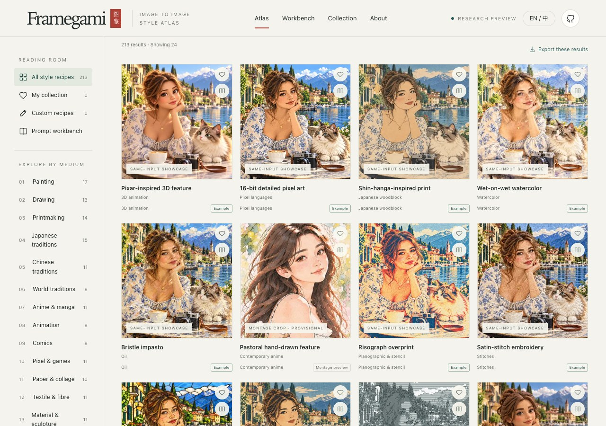
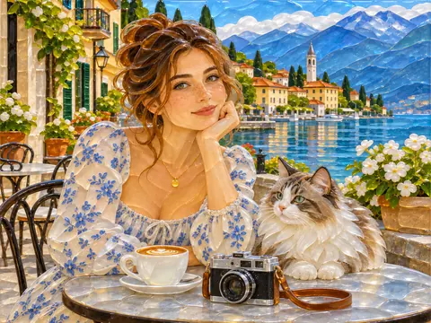
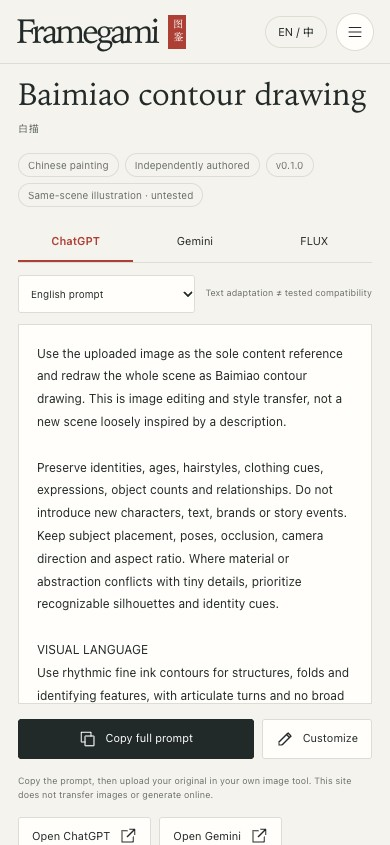

# Framegami

**213 image-to-image styles, with visual examples and copyable prompts in English and Chinese.**

[**Browse styles ↗**](https://patshin.github.io/framegami/en/) · [中文](README.md)

[](https://patshin.github.io/framegami/en/)

## Styles

| [](https://patshin.github.io/framegami/en/style/baimiao/) | [](https://patshin.github.io/framegami/en/style/sashiko/) | [](https://patshin.github.io/framegami/en/style/fused-glass/) |
|:---:|:---:|:---:|
| [Baimiao](https://patshin.github.io/framegami/en/style/baimiao/) | [Sashiko](https://patshin.github.io/framegami/en/style/sashiko/) | [Fused glass](https://patshin.github.io/framegami/en/style/fused-glass/) |

## Use a prompt

<table><tr><td valign="top">Open a style, pick a model and language, and select Copy full prompt. Upload your photo to your image tool and paste the prompt.</td><td width="240"><a href="https://patshin.github.io/framegami/en/style/baimiao/"></a></td></tr></table>

## Run locally

Node.js 22

```sh
npm run build
npm run preview
```

## Sources and license

The gallery contains 155 independent AI illustrations, 30 montage crops and 28 procedural previews. Exact-prompt verification is pending for all 213 styles.

[Image sources](evidence/image-coverage.json) · [Contributing](CONTRIBUTING.md) · [MIT license](LICENSE) · [Content license](CONTENT-LICENSE.md)
