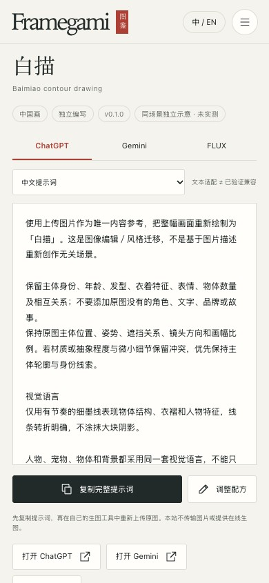

# Framegami

**213 种图生图风格，每种都有示例图和可复制的中英文提示词。**

[**浏览图鉴 ↗**](https://patshin.github.io/framegami/zh/)　·　[English](README.en.md)

[](https://patshin.github.io/framegami/zh/)

## 风格示例

| [](https://patshin.github.io/framegami/zh/style/baimiao/) | [](https://patshin.github.io/framegami/zh/style/sashiko/) | [](https://patshin.github.io/framegami/zh/style/fused-glass/) |
|:---:|:---:|:---:|
| [白描](https://patshin.github.io/framegami/zh/style/baimiao/) | [刺子绣](https://patshin.github.io/framegami/zh/style/sashiko/) | [熔融玻璃](https://patshin.github.io/framegami/zh/style/fused-glass/) |

## 使用提示词

<table><tr><td width="53%" valign="top">打开一个风格，选择模型和语言，点击「复制完整提示词」。在你使用的图像工具里上传照片，粘贴提示词。</td><td><a href="https://patshin.github.io/framegami/zh/style/baimiao/"></a></td></tr></table>

## 本地运行

Node.js 22

```sh
npm run build
npm run preview
```

## 来源与许可

图库包含 155 张独立 AI 示意、30 张拼图裁切和 28 张程序化预览。严格逐字 Prompt 验证为 0 项。

[图片来源](evidence/image-coverage.json) · [维护与贡献](CONTRIBUTING.md) · [代码许可](LICENSE) · [内容许可](CONTENT-LICENSE.md)
